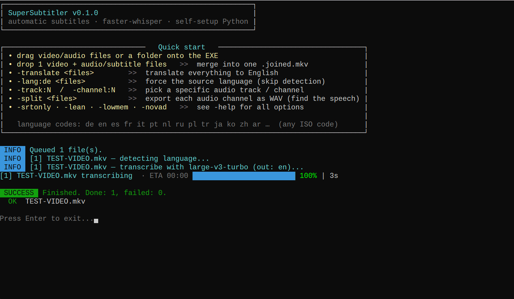

<div align="center">

# 💬 SuperSubtitler

### Drop a video, get clean subtitles back: automatic speech-to-subtitle, drag-and-drop.

**Automatic subtitle generator with faster-whisper, for Windows. International, GPU-accelerated, one EXE.**
*Free for everyone, at home or at work — open source under the [GPLv3](#-license).*
Subtitles appear **only while someone is speaking** — no subtitles stuck on screen during silence.

*Powered by [faster-whisper](https://github.com/SYSTRAN/faster-whisper) and [FFmpeg](https://ffmpeg.org), which do the actual speech recognition and audio work. SuperSubtitler is the automation, language logic and safety layer around them.*

[](#-requirements)
[](#-requirements)
[](https://github.com/SYSTRAN/faster-whisper)
[](#-building-from-source)
[](#-license)

**[⬇️ Download the latest release](https://github.com/burnersen/SuperSubtitler/releases/latest)** · **[🌐 Website](https://tech.burnersen.de/en/tools/supersubtitler-en/)** · **[☕ Buy me a coffee](https://ko-fi.com/T5G0219GA6)**

<sub>🇩🇪 Auf Deutsch: [tech.burnersen.de/tools/supersubtitler](https://tech.burnersen.de/tools/supersubtitler/)</sub>



*A 30-second sample — recognized flawlessly, in English.*

</div>

---

## ⚡ 30 seconds, no manual

1. Download `SuperSubtitler.exe`, a single file with nothing to install.
2. Drag a video or audio file (or a whole folder) onto it.
3. Done. You get a `Movie.<lang>.srt` next to it **and** a `Movie.subbed.mkv` with the subtitle track built in.

On first run SuperSubtitler sets itself up automatically: it downloads FFmpeg, a self-contained Python, the faster-whisper engine and the speech models — no installs, no PATH fiddling, no Python knowledge needed. Every download shows its progress (MB, speed); `-setup` does all of it in one go without processing a file. After that, everything runs offline and locally; your audio never leaves your machine.

---

## ✨ What SuperSubtitler does

- 🔇 **No "sticky" subtitles.** A voice-activity filter means a line shows up **only when someone actually speaks** and disappears in the silence — no caption frozen on screen through a quiet scene. This was the whole reason this tool exists.
- 🌍 **International by default.** Every track is transcribed in **its own language** (German stays German, Spanish stays Spanish…). Add `-translate` to translate everything to English instead.
- ⚡ **GPU-fast, CPU-safe.** Runs on your NVIDIA GPU via auto-installed CUDA libraries (a 1h45 film in ~80 seconds on a modern card), and falls back to the CPU automatically if there's no GPU.
- 🎚️ **Multi-track aware.** A file with several audio tracks (e.g. German + English) lets you pick which ones to subtitle — each becomes its own language-tagged subtitle track in one MKV.
- 🧩 **Merge mode.** Drop one video together with extra audio and/or subtitle files and it offers to mux them into one `.joined.mkv` (lossless copy). The result is never silent — if you don't add audio, the video keeps its own.
- 📐 **Subtitles built right.** Word-level timing, two-line wrapping, sensible characters-per-second, minimum/maximum duration and anti-flicker gaps — close to professional (Netflix/BBC) guidelines.
- 🧹 **SRT cleaner.** A plain-text term list strips ads and hallucinated junk lines (you control every term; nothing is hard-coded).
- 🛡️ **Resilient by design.** Stall watchdog against frozen GPU/engine, per-file crash isolation, output validation, and a Windows Job Object so killing the tool kills every helper it started — no orphan processes.
- 📦 **Ships with its own source.** The EXE carries its own source code (Go `embed`) and extracts it on first run.

---

## 🖥️ Prefer a window?

**SuperSubtitlerGUI** (in [`gui/`](gui/README.md)) puts all of this behind buttons: drag and drop, tick boxes for audio tracks, one-click language questions, live progress per file and on the taskbar, Merge and Split pages, and a Settings page built from the config file itself (with "Restore defaults"). It drives the unchanged `SuperSubtitler.exe` — same engine, same results.

---

## 📌 The same tested runtime for everyone

A fresh install used to take the newest of everything — and one day a new PyAV release broke every new installation. Now SuperSubtitler installs one **tested set**, the same for every user, written into the EXE ([`runtime.json`](runtime.json)):

- **Exact versions** of Python (3.12.10), pip, FFmpeg (8.1.2), faster-whisper, CTranslate2, PyAV, every other package and the CUDA libraries — pip installs them with `--require-hashes`, so nothing unlisted slips in.
- **Speech models at an exact revision** (large-v3-turbo, large-v3).
- **Every file is checked against its SHA-256** before it is used; a damaged or changed download is refused.
- **Own mirror first:** Python, pip and the models come from this project's [`runtime-v1` release](https://github.com/burnersen/SuperSubtitler/releases/tag/runtime-v1) first and only then from their original source — a renamed or deleted upstream repository cannot break an install. (Files over 2 GB are stored in parts and joined while downloading.)
- **Checked for real:** CI installs exactly this set on Windows and subtitles a test clip on every change.

Updating is deliberate: raise the versions in `runtime.json`, CI green, release. Existing installs switch to the new set automatically on their next start. Experts can still set their own `engine_spec` or models in the INI — that is installed as written, without the guarantee.

---

## 🗣️ Language handling

- **Default:** the spoken language of each track is detected (a sample is taken, split into windows and majority-voted) and the subtitles are written **in that language**.
- **`-translate`:** translates everything to English (the only target Whisper translates to). Uses the large model, which is required for translation.
- **`-lang:XX`:** skip detection and force a source language, e.g. `-lang:de`, `-lang:es`, `-lang:fr`.
- **Mismatch?** If a file's language tag disagrees with what the audio actually is, you're asked which to trust (pressing Enter keeps the detected language).
- **All questions up front.** Track choice and language questions are all asked at the start, before the long transcription part begins — once the progress bars appear you can walk away. With `-auto` nothing is asked at all.

---

## 🚀 Usage

```
SuperSubtitler.exe [flags] [files/folders]
```

Drag files or folders onto the EXE, or pass them as arguments. Flags and files may be given in any order.

| Flag | Effect |
|---|---|
| *(none)* | Subtitle every dropped video/audio file in its own language |
| `-translate` | Translate every track to English |
| `-lang:XX` | Force the source language (ISO code, e.g. `-lang:de`); skip detection |
| `-track:N` | Use audio track N (1-based) instead of asking/auto-selecting |
| `-channel:N` | Isolate physical channel N (0-based) of the chosen track |
| `-srtonly` | Write only the `.srt`, no MKV |
| `-lean` | In the MKV keep only video + the subtitled audio + the new subtitles |
| `-novad` | Disable the silence filter (transcribe everything, pauses included) |
| `-lowmem` | Smaller compute type (less video memory, a bit slower) |
| `-split` | Export each audio channel as a WAV to find the speech; skip transcription |
| `-auto` | Never ask: all audio tracks, the detected language, merge = yes |
| `-force` | Redo files that already have subtitles (overwrites the old results) |
| `-out:FOLDER` | Write the `.srt`/`.mkv` results into FOLDER instead of next to the source |
| `-nowait` | Don't wait for Enter at the end (for scripts and shortcuts) |
| `-setup` | Download and install everything, speech models included, then exit |
| `-nomerge` | Never offer the merge mode; subtitle every dropped file |
| `-json` | Machine-readable events on stdout, one JSON line each (for front-ends) |
| `-version` | Print the version and exit |
| `-help` | Show the banner and full options list |

**Supported input** — Video → `.subbed.mkv`: `mkv mp4 mov m4v avi ts m2ts webm mpg wmv flv 3gp` · Audio → `.srt` only: `m4a mp3 wav flac aac ogg opus m4b`

---

## 🧩 Merge mode

Drop **one** video together with one or more audio and/or subtitle files, and SuperSubtitler offers to mux them into `<video>.joined.mkv` — losslessly, no re-encode:

- **Audio:** the dropped audio file(s). If you don't drop any, the video keeps its own audio (the result is **never** silent).
- **Subtitles:** the dropped subtitle file(s). If you don't drop any, the video keeps its own.
- Dropped tracks are language-tagged from their file names (`Movie.de.srt` → German) when recognisable — so SuperSubtitler's own `.<lang>.srt` outputs slot back in perfectly.

---

## ⚙️ Configuration

Two plain-text files are created next to the EXE on first run:

- **`SuperSubtitler_Config.ini`** — models, the silence-filter settings, lead-in, surround handling and all subtitle formatting limits (chars per line, CPS, min/max duration, …). Invalid values reset the file to its documented defaults.
- **`SuperSubtitler_SRTCleaner.txt`** — one term per line to delete from results (ads, junk). A line starting with `=` only matches when the whole subtitle equals it exactly. Nothing is hard-coded; you decide every term.

---

## 💻 Requirements

- Windows 10/11 x64
- An NVIDIA GPU makes it much faster (CUDA libraries are auto-installed); **without one it automatically falls back to the CPU** (slower, but works)
- FFmpeg, Python and the speech models are downloaded automatically on first run (a few GB, once, cached next to the EXE)
- First run reaches `github.com` (this project's runtime mirror and FFmpeg), `pypi.org`, and — only if the mirror is unreachable — `python.org` and `huggingface.co`

---

## 🛡️ Windows SmartScreen / antivirus warnings

Windows or your antivirus may warn you the first time you run `SuperSubtitler.exe`. The honest reason: **the EXE is not code-signed.** Signing certificates cost hundreds of euros per year, and this is a free hobby project with zero income. Unsigned Go binaries are frequent false-positive targets; there's nothing I can do about it except be transparent.

You don't have to trust me blindly:

- **Scan it:** upload the EXE to [VirusTotal](https://www.virustotal.com) before running it.
- **Read it:** the complete source code is right here in this repository.
- **Build it yourself:** clone, run `build.bat`, done. (The downloaded EXE even carries its own source inside and extracts it on first run.)

If SmartScreen blocks the start: click **"More info" → "Run anyway"**.

---

## 🔨 Building from source

```
build.bat
```

The window lives in `gui/` and has its own `gui/build.bat` (writes `SuperSubtitlerGUI.exe` next to `SuperSubtitler.exe`).

`build.bat` packs the embedded source archive, runs `go mod tidy` and compiles `SuperSubtitler.exe` (Go 1.22+). The only external dependency is [pterm](https://github.com/pterm/pterm). The EXE is written to the parent folder, ready to run next to its downloaded FFmpeg/Python/models. Every released EXE also extracts its own sources on first run.

---

## 🧑‍🎨 The story

SuperSubtitler is a personal hobby project. I wanted subtitles that behave: text when there's speech, nothing when there's silence — no caption stuck on screen through a quiet scene. Once that worked, it grew into a proper international, multi-track tool. It started as a tool just for me, but if it fits your workflow too, all the better.

---

## ❤️ Support

SuperSubtitler is a hobby project, free for personal use. If it saved you hours of typing:

- ⭐ **Star this repo** — fame is the currency here
- ☕ **Buy me a coffee** — keeps the project going:

[](https://ko-fi.com/T5G0219GA6)

Found a bug? Open an issue with the console output.

---

## ⚠️ Disclaimer

SuperSubtitler is free hobby software, provided **"as is", without any warranty or condition of any kind**. It was built and tested with care, but you use it **at your own risk**. As far as the applicable law allows, the author is not liable for any damages or data loss arising from the use of this software. See sections 15 and 16 of the [license](LICENSE).

---

## 📜 License

SuperSubtitler — the console tool and the window in [`gui/`](gui/) — is free software under the [GNU General Public License, version 3](LICENSE) — that version only (`GPL-3.0-only`).

- **Use it:** Anyone may use SuperSubtitler free of charge, at home or at work, and read, change and share its source code.
- **The one condition:** Whoever passes on SuperSubtitler or parts of it — unchanged, changed or built into a program of their own — must include the complete source code and pass everything on under the same license. A closed, paid product with SuperSubtitler inside is therefore not possible.
- **Free of charge:** SuperSubtitler is and stays free. The official source is [github.com/burnersen/SuperSubtitler](https://github.com/burnersen/SuperSubtitler) — anyone asking money for SuperSubtitler is selling you what you can get here for free.
- **A separate license for companies:** Want to build SuperSubtitler into a product that is not meant to be under the GPLv3? You can ask the author for a separate license — just [open an issue](https://github.com/burnersen/SuperSubtitler/issues).

Versions up to and including 0.1.0 were released under the PolyForm Noncommercial License 1.0.0; from 0.2.0 on, SuperSubtitler is under the GPLv3.

### Third-party components

The exes are built with these Go libraries. Each keeps its own license, and all of them are compatible with the GPLv3:

- **MIT License:** [pterm](https://github.com/pterm/pterm) with [atomicgo/cursor](https://github.com/atomicgo/cursor), [atomicgo/keyboard](https://github.com/atomicgo/keyboard) and [atomicgo/schedule](https://github.com/atomicgo/schedule), [gookit/color](https://github.com/gookit/color), [lithammer/fuzzysearch](https://github.com/lithammer/fuzzysearch), [mattn/go-runewidth](https://github.com/mattn/go-runewidth), [rivo/uniseg](https://github.com/rivo/uniseg), [xo/terminfo](https://github.com/xo/terminfo); for the window [Wails](https://github.com/wailsapp/wails) and its libraries
- **Apache License 2.0:** [containerd/console](https://github.com/containerd/console)
- **BSD 3-Clause License:** the [Go standard library](https://go.dev/LICENSE) and [golang.org/x/sys](https://github.com/golang/sys), [x/term](https://github.com/golang/term), [x/text](https://github.com/golang/text)

Their copyright notices and full license texts are in the repositories linked above.

### Engines & attribution

SuperSubtitler does **not** bundle these; it downloads or invokes them:

- **faster-whisper** — speech recognition engine by [SYSTRAN](https://github.com/SYSTRAN/faster-whisper) (MIT), installed via pip on first run. It runs OpenAI's **Whisper** models (MIT).
- **FFmpeg** — all audio/video processing. On first run the pinned build 8.1.2 "essentials" by [gyan.dev](https://www.gyan.dev/ffmpeg/builds/) is downloaded from its [versioned GitHub release](https://github.com/GyanD/codexffmpeg/releases/tag/8.1.2) (GPL) and checked against its SHA-256; FFmpeg is a separate work by the [FFmpeg project](https://ffmpeg.org) under its own license and is invoked as an external program.
- **Python** — the official python.org Windows embeddable build, downloaded on first run to host the engine.

Python, pip and the Whisper model files are additionally mirrored, unchanged, in this repository's [`runtime-v1` release](https://github.com/burnersen/SuperSubtitler/releases/tag/runtime-v1) (PSF and MIT licences, which allow redistribution; the notices are listed there). FFmpeg is deliberately not mirrored: as a GPL binary it would come with the duty to ship its full source, so it is fetched from gyan.dev's permanent versioned release instead.
